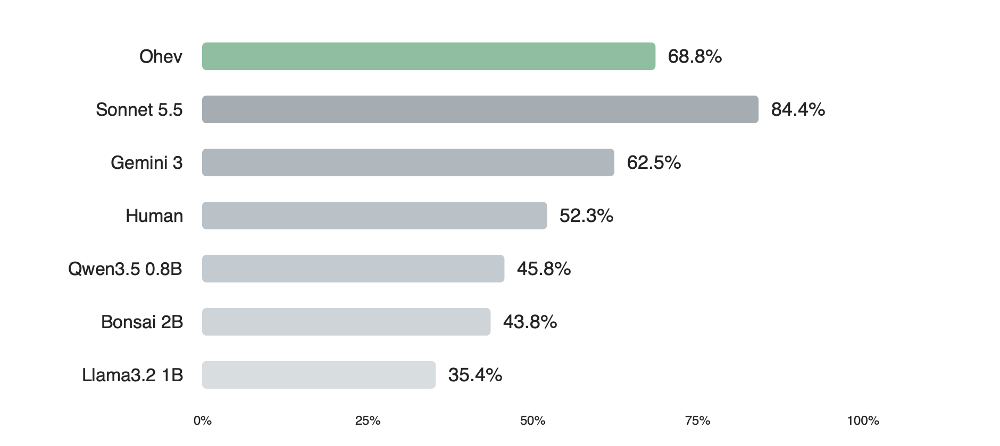
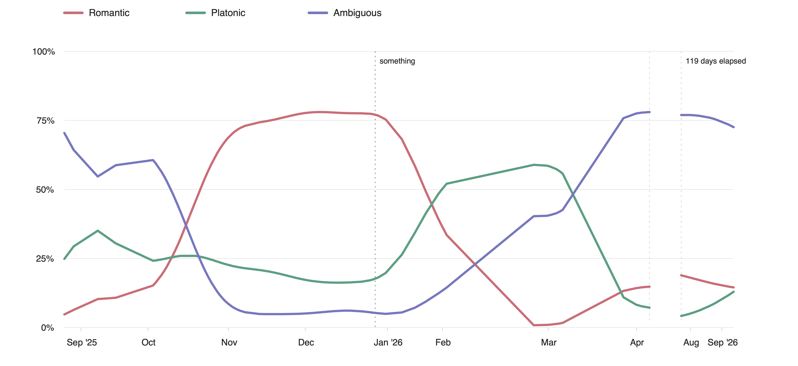
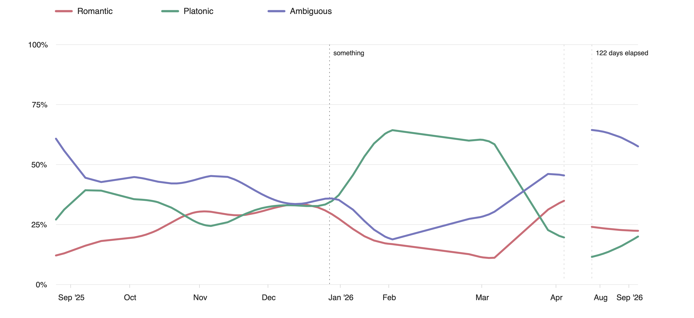

This was a quick little weekend project. In the past, I’ve found myself in multiple situations where I couldn’t between the lines and ended up making things awkward. While reading a [HackerNews thread](https://news.ycombinator.com/item?id=49717558) on Jev, I had a sudden realization that I am a victim of [Sutton’s bitter lesson](http://www.incompleteideas.net/IncIdeas/BitterLesson.html). My hand written heuristics for interpreting social cues were not going to scale.

I decided to throw compute and data into this heavyweight problem.

Flirting is similar to an imperfect and incomplete information game, given the underlying preferences are private and whatever interaction we have is only a *partial* view of the situation. Additionally, meaning isn’t dependent upon the words themselves, things are dependent upon conversational context and what the speak is trying to accomplish. Nevertheless, getting nerd-snipped by linguistics barely helped me anytime.

I wanted to put a few small local models to the test.

## Will it even work?

A few people on Discord pointed out that we can not reliably know how two people normally talk, how long they've known each other, or what their interactions look like outside the provided context, which is completely right.

I am borrowing the imperfect information framing from [Suspicion-Agent: Playing Imperfect Information Games with Theory of Mind Aware GPT-4](https://arxiv.org/abs/2309.17277) (Guo et al.), but I won’t be including its Theory-of-Mind reasoning or opponent modeling.

We will be dealing with proxies all the way down because messages are imperfect evidence of intentions and human interpretations are imperfect substitutes for ground truth. But it would be fun to approximate those interpretations — and that’s what I am trying to aim.

## Where do I get high quality data?

My first idea was to synthetically generate a lot of conversations. I used GPT 6 Luna to pump out a few hundred conversations, then started reading them. It was simply a waste of tokens as the entire corpus was a caricature of flirting. All I found were variations of “just the two of us” phrases and awkward confessions.

In search of a “high quality” dataset, I read a few papers on flirting styles, conversational pragmatics, and communication styles. Then I went to Reddit and started OCR-ing screenshots that I felt could be useful. I built a rubric using my findings. Each synthetic situation had variables like relationship history, familiarity, intention, reciprocity and competing explanations for the behavior (thanks to Reddit comments). I started with 60 examples, then manually audited them to use as a seed. At the end, I had 200 examples divided ~equally among romantic, platonic and ambiguous situations.

## We need an eval

We ought to have an eval now. I used GPT Sol to generate a few situations, then picked the ones I could not understand at all (even after using my heuristics). I used them to generate 50 high quality entires. Then I convinced (read: *forced*) a few friends, and made them attempt the eval (blindly) three times. I calibrated the keys using their input, and then let Qwen 3.5 0.8B attempt them multiple times. It correctly inferred ~46% of the situations. I am not satisfied with the final eval suite though -- it still feels inadequate.

## It’s time to (post) train

I used Unsloth’s training [recipe](https://unsloth.ai/docs/basics/train-your-own-decision-model-with-unsloth), and extended it support ternary decisions. I attached a decision head to Qwen3.5 0.8B. I repeated the experiment using multiple seeds on my Mac M5 and and it took around ~6-7 mins on average. The idea was to have 5 models do inference on the same problem, and then use their consensus (veto power) as the final answer. Let’s call the model Ohev.

<pre class="ohev-code"><code>import ohev
result = ohev.judge(
		"They met in a writing group and have started messaging privately.",
		(
			"did you finish the story?",
			"almost. wanted you to read it first"),
		)
print(result)</code></pre>

## Testing in the Wild

I convinced (read: *forced*) 4-5 friends to attempt the eval, and benchmarked a few small LMs (+ Sonnet 5.5 and Gemini 3). The  X-axis refers to their mean performance over 5 runs. We measure the alignment with the held out labels (again, this is not a real life guarantee).

Next I deployed it to do post-hoc analysis of my exported chats. I did rolling-window-context aggregation, and picked two messages at a time to plot the findings. There were 20k messages.

Here are my messages with respect to the other person’s:

Meanwhile, its theirs with respect to mine:

The model found considerably stronger romantic signals in my messages than in theirs. Both trajectories changed after I said something which made things awkward, things eventually turned platonic and faded away. The initial curves had more data points, while the post-March curves are coarser approximations.

Of course, these are the models’ judgments about the messages, not a record of anyone's actual feelings.

## Was it worth the effort?

For me? Yes. I genuinely lack the ability to understand any cue, and it has been of great help. I can stop thinking and carry on with my life quickly instead of doing Bayesian inference inside my head. Neither is it perfect, nor the whole process, and the calibration is subpar. But at least, it’s a good proof of concept, and I’ll come back to explore imperfect information games once more. I had fun here.

[HuggingFace](https://huggingface.co/datavorous/ohev)
