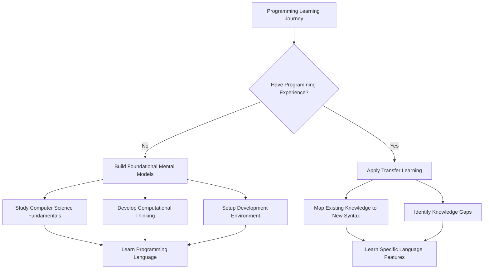
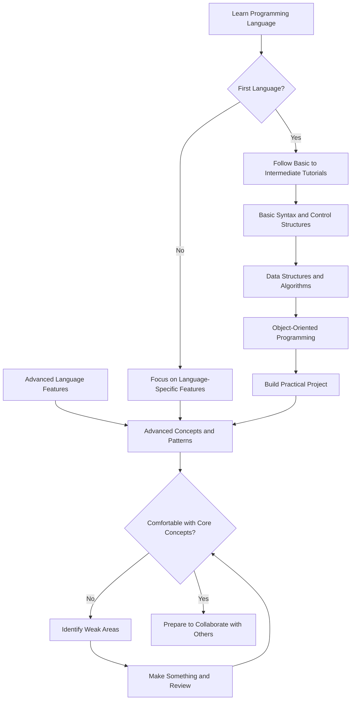
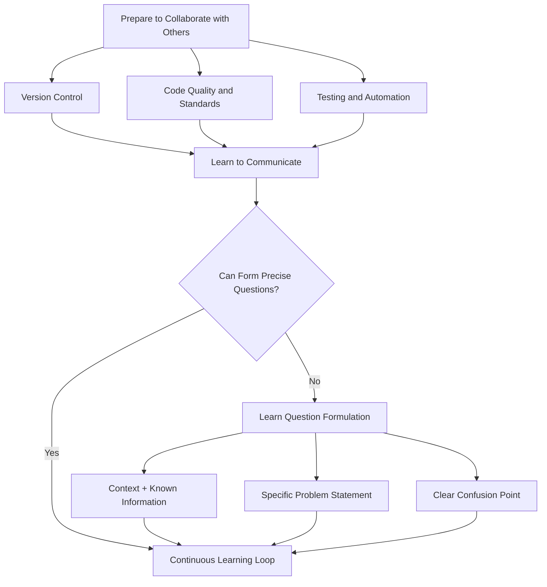
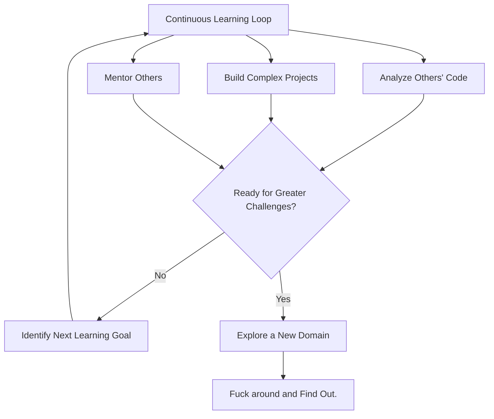
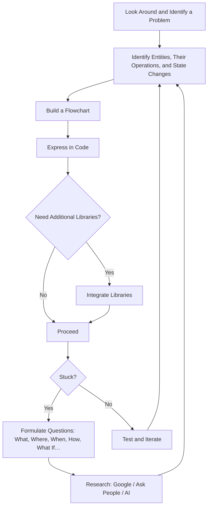

# Perchance, the Lines of Woe

A general guide to stop asking vague questions related to programming. A universal plug-n-play blueprint for pretty much everything.

## Absolute Beginner

### Building Mental Models

- Video Playlist: [Computer Science Crash Course](https://youtube.com/playlist?list=PL8dPuuaLjXtNlUrzyH5r6jN9ulIgZBpdo&si=n3GuvgSLc-y5V5x8)  
**Reason:** To build a foundational understanding of core computer science concepts before diving into programming, which helps develop context and motivation for learning syntax and logic.  

- Articles: [Introduction to Computational Thinking](https://griffithunilibrary.github.io/intro-computational-thinking/content/0-intro.html)  
**Reason:** To develop problem solving skills by learning how to break down complex tasks, recognize patterns, create step-by-step solutions (algorithms), and apply abstractions.
	- Identify the steps involved in computational thinking
    - Break a problem down into more manageable parts
    - Develop a series of steps (also known an algorithm) to solve a problem
    - Generalise important detail so that algorithms can be made re-usable (this process is called abstraction)  

- Claude Article: [Modelling Real Life Situations](https://claude.ai/share/be708a47-dbe6-43c6-9604-eab96d35c4f8) with data, algorithms and behaviors. IF you don't read and try out the examples, you're not gonna make it far.

!!! tip "Suggested For You"
    When you encounter any system (a coffee shop, a library, a video game), ask yourself:  
    What are the key entities here?  
    How do they interact?  
    What rules govern their behavior?  
    How would I represent them in a flowchart?  

### Typing Glyphs on Screen

#### Setup a Code Editor
- [VSCode](https://youtu.be/D2cwvpJSBX4?si=M-n-rClsXlgaTTpm) (Add Extensions: Python, Flake8, Pylance)
- Sublime Text (Download, [Add Terminal](https://www.geeksforgeeks.org/linux-unix/how-to-use-terminal-in-sublime-text-editor/), Change Theme)

#### Learn a Basic Language:

##### Python
- Install the Python Interpreter. Remember to check the "Add Python to PATH" while installing.  
- Learn the basics from [this tutorial](https://youtu.be/8KCuHHeC_M0?si=_-k4oFfBxjpst_wV)
- Try out [intermediate](https://www.youtube.com/watch?v=HGOBQPFzWKo) level python programming.
- Learn Basic Data Structures and Algorithms - List, Tuple, Queues, Sets, Stacks, Dictionaries (hashmaps)
!!! tip "Tip"
    Come back again, and learn more about data structures and algorithms. There are thousands of articles and videos on the internet covering DSA. I recommend reading the book called [Introduction to Algorithms](https://www.cs.mcgill.ca/~akroit/math/compsci/Cormen%20Introduction%20to%20Algorithms.pdf). Read [this](https://www.reddit.com/r/algorithms/comments/cw7m5h/how_to_read_book_introduction_to_algorithms/) thread on how you should read it.  
    Can't stress this enough, just [search](https://chatgpt.com/share/68947f7b-ca04-800d-a5d0-96d7e3de0c83) for it.
- Understand [Object Oriented Programming in Python](https://www.youtube.com/watch?v=JeznW_7DlB0)
- [Build the Snake Game](https://youtu.be/QFvqStqPCRU?si=_xvcC0xm51I3iUCr) with `pygame`

You should be thinking, *"Now I know what lists, tuples, classes, methods, loops, and libraries like Pygame are. I already have the fundamentals laid out in front of me. So now, I should build some projects to truly understand whether I can bring something to fruition from just a mere idea."*. If you're not thinking this way, you may need to slow down and reflect more.

Your next station should be `google.com` or `chatgpt.com`.  
Ask questions/for suggestions/ideas. Form questions like:  

- *I already know `{insert whatever you know here}`, what things do I need to learn for making `{insert name}`?*  
- *I have structured my project like this: `{insert your project directory structure}`, how can I improve from here? Is there any standard procedure to initiate new projects?*  
- *I am using Object Oriented Programming for my `{insert project name}`, viz. `{some code snipppet}`. Are there other ways to structuring my code?*  
- Or funnily enough: *I am an intermediate python programmer, generate more questions for me, which will help me improve. Some examples: `{insert the 3 points which I have mentioned above}`*  
- Google: *python libraries for {anything you desire: eg: webscrapping/api/faster matrix multiplication}*, *standard guidelines for writting python code* etc.  

!!! danger "LISTEN CAREFULLY"
    In this way, you'll be able to understand that most of it is just **planning out** what you wish to build on a piece of paper, finding the **right tools**, and then **expressing the logical flow** of instructions using a particular syntax.  
    It is highly recommended to use LLMs like ChatGPT, Claude, Qwen as **mentors**, who won't code for you, but engage in brainstorming sessions.

##### The C Language
- Install GCC compiler.
- Assuming that you have already done Python: [Brief overview on how you can map one language's syntax with another](https://chatgpt.com/share/689429d4-88fc-800d-bfb1-f04dd60092c7) and a [Comprehensive Guide](https://claude.ai/share/ef8db348-d74b-4145-9b35-1f1e556b69b6)
- Learn how to scaffold a C project, and use a Makefile. [Read More](https://claude.ai/share/6e19775a-d923-435b-a182-87c89a69d311)
- [Beej's Guide to learn C](https://beej.us/guide/bgc/)
- [Pointers in C](https://www.youtube.com/watch?v=MIL2BK02X8A) and [Memory Management](https://www.youtube.com/watch?v=rJrd2QMVbGM)
- [My 2 Year Journey of Learning C - VoxelRifts](https://youtu.be/lMvFWKHhVZ0?si=tF9r3T9kPgjYwglN) : A good watch, get some idea on what you can build.

### Flowchart

Moving forward from here, be retrospective.  
Ask yourself:  

- *What am I having a problem with? What can I create that will help me understand the nuances of C programming even better?*

- *What are the unique features of a language like C? One of them is that it gives me full control over my machine. Well, since it gives me full control, I should be able to create something that interacts with or operates on my machine at a considerably lower level... hmm, maybe a notification daemon that runs continuously to remind me to drink water? I could use Python as well, but hey, that would consume much more resources than C! Okay, that’s it, I’m going to make it in C!*

!!! tip "Recreate"
    Brainstorm more questions all by yourself.    

!!! warnings "How to Debug?"
    Well, that's a very good question. You'll discover it along the way. To put it in short: First read error messages systematically, then isolate problem areas, use print statements strategically and/or use IDE debuggers. Anyway, you'll realise the importance of writing Unit Tests eventually. (I realised that very late)

## You are Not Scared Anymore

**Needs:** Collaborate, Versioning, Linting, Docs and More

### Git and Collaboration

This is a VERY IMPORTANT section.

- Learn about [Git and Github](https://youtu.be/DVRQoVRzMIY?si=uRfudzDI6spRfguS). They are not the same, don't let their names fool you. As a beginner, at least know these:
`git init, git config, git status, git add, git commit, git log, git clone, git branch, git checkout (or git switch), git merge, git pull, git push, git remote -v, git fetch, git rebase, git diff, git stash,git reset, git tag, git pull upstream`  
**Reason:** Centralize your code, track every change, and enable team collaboration via pull/merge requests.
- Write clear commit messages, examples:
    * `feat: add user authentication module`
    * `fix: resolve race condition in data loader`
    * Use issue trackers to plan and discuss tasks

### Linting and Formatting

- Use **formatters** like [Prettier](https://prettier.io/) (JS/CSS), [Black](https://black.readthedocs.io/) (Python) and **linters** like ESLint, Flake8
  **Reason:** Maintain a consistent code style and catch potential errors before runtime.

  * Add pre-commit hooks with [pre-commit](https://pre-commit.com/)
  * Configure IDE extensions to autoformat on save

!!! danger "REMEMBER"
    Agree on a style guide (e.g., Airbnb for JavaScript, PEP 8 for Python) at the project’s outset to avoid endless debates about semicolons or indentation.

### More

Learn how to write tests, build systems, automations, CI/CD pipelines, logging, profiling, design patterns etc. There are numerous resources on the internet, and you already know how to search and learn from them.

## The Art of Technical Questioning

Your growth as a programmer is directly tied to **how well you form questions**, both for search engines and AI assistants.

### Stop Asking Like This

> *"How do I make a calculator in Python?"*  
> *"Fix my code."*

These are dead-end prompts. They attract shallow answers and teach you nothing.

### Ask Like This Instead

> *"I want to build a calculator that handles complex mathematical expressions. I understand basic arithmetic operations, but I'm unsure how to parse expressions like `(2 + 3) \ 4`. What concepts should I research? What algorithms should I look for?"*

> *"I'm implementing binary search. My code works for sorted arrays, but fails with duplicate values. Here's my logic: `{explain it}`. What am I overlooking about how binary search handles duplicates?"*

!!! tip "Try"
    Always mention what you **already know**, what you've **already tried**, and what you're **actually confused about**.

Here are additional examples:

> *"My recursive Fibonacci function becomes slow for inputs over 35. I suspect it's recalculating values. Can you walk me through with any technique to minimize recalculation?"*

> *"Here’s my inventory management system using OOP. Here’s the class structure: `{insert code}`. What design patterns could simplify this?"*

> *"I think using a dictionary for user preferences will be faster than a list, since dict lookups are O(1) and list searches are O(n). Is there any better way?"*

!!! warnings "Read Code Written By Others"
    What you'll need: A pen and a notebook. Go and peek into the code of any Github repository you find.

## Ending Note

From my experience, I've learned that the main bottlenecks in programming are *problem-solving time* and *persistence*. With consistent effort, both can be improved. I'm still learning myself and have only scratched the surface. All the information presented here is the culmination of lots of trials and errors, copy pasting from StackOverflow, being embarrassed on Discord servers, subreddits, forums, code reviews and general discussions with other programmers. I did not know what linting meant, or why should I use `uv` in the first place. I didn't understand the importance of Git and assumed that the GitHub web UI would be sufficient for a long time. 10 months ago, I did not know how to handle a CI pipeline for Github Actions. But as humans, we're capable of learning quickly. Learning Never Stops.

## TLDR

**Understand and Plan:** Build core CS mental models (videos/articles + flowcharts) before coding.  
**Setup and Learn:** Configure your editor, pick a first language (Python), master basics (syntax, data structures, simple projects).   
**Ask Precisely:** When stuck, state what you know, tried, and exactly where you’re stuck, use Google/AI for guidance, not answers  
**Collaborate and Iterate:** Use Git, linters, tests, CI/CD; review others’ code, build projects, mentor.  
Repeat the learning loop.

There is no end.  

For suggestions/corrections, please [email](mailto:datavorous.work@gmail.com) me.
