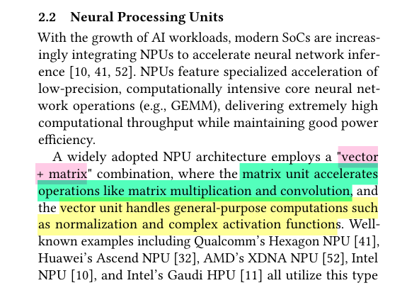
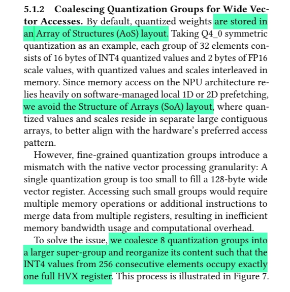

There is a distinct lack of articles on the internet to explain why we don't achieve the desired performance from NPUs, after model deployment. There are either research papers, or marketing fluff.

This document serves as a middle ground, and explains the hardware underneath in a simplified way, to help diagnose bottlenecks faced during model inference on edge hardware.

Most graph fragmentation problems are caused by a small set of well defined hardware constraints, and can be avoided or bypassed. Hence, we will focus on the categories of operation the silicon refuses, why, and where in our model-export pipeline those refusals originate.

## What an NPU actually is

An NPU is a chip block designed to run neural network math, mostly matrix multiplies and a small set of element-wise ops, at a very high arithmetic/watt rate but at the cost of losing generality. Unlike a CPU or GPU, which fetch and decode instructions every cycle, an NPU is *configured* once per subgraph. A specialized compiler emits a binary that wires the chip's compute blocks (matrix unit, vector unit, on-chip SRAM, DMA engines) into a fixed dataflow for your specific computation, and then the data streams through it with almost no per-cycle control overhead. The cost of this efficiency, as stated earlier, is that anything outside the supported set falls off a cliff.

The architectural family is well described in the recent paper *Scaling LLM Test-Time Compute with Mobile NPU on Smartphones* (Hao et al., EuroSys '26), which calls out the standard pattern:

Qualcomm Hexagon will be used repeatedly as the concrete example in this document (it's the most widely deployed mobile NPU and has the most accessible SDK).

*Refer to figure 3 of the paper linked above*

## How an NPU executes a model

We first need a working picture of what happens when we hand a model to an NPU.

### Compile time

When we point a tool like QAIRT (for Qualcomm), Vitis AI (for AMD XDNA), or CoreML's compiler at our model, it doesn't produce a stream of instructions in the CPU/GPU sense, rather it produces a configuration binary, which is a description of how to wire the chip's compute blocks together for any specific computation. This is the single most important conceptual difference from a GPU compiler.

We construct a computation graph from our given source (can be a `.tflite` flatbuffer, ONNX model etc.), then we read and walk the nodes. For every node, we check the two gates which were mentioned in the introduction - *do I have a builder for this op?* and *does this specific config validate?* The result would be a boolean mask over the graph.

Then continuous runs of accepted ops get extracted as subgraphs. Everything else stays in the host graph as fallback ops. Each accepted subgraph becomes its own independent compile target. Now within a subgraph, the compiler finds sequences it can wire together without immediate memory round trips. For example, `matmul -> bias -> activation -> layernorm`. The matrix unit's output can feed directly into the vector unit's input, the vector unit chains its own stages, and the whole sequence becomes a single configuration rather than four.

The on-chip SRAM is quite small (single digit megabytes on Hexagon's VTCM, similar elsewhere), whereas a 4096x4096 FP16 weight tensor is 32MB on its own, which is too large to fit. Hence the compiler has to slice the operation into tiles that fit in the scratchpad alongside their corresponding activation slices, schedule DMAs to bring their next tile in while the current tile computes, and decide which intermediates stay on-chip versus spilling into the DDR.

Now the compiler writes out the final binary which dictates the wiring map for the chip's compute fabric, the DMA schedule, the scalar controller's sequencing program, weights pre-arranged into hardware native layouts (because the systolic array consumes data in a specific order; the EuroSys paper has a nice illustration of Hexagon's "every two rows are permuted" tile format), and the quantization parameters needed for runtime scaling.

### Runtime

When inference starts, the scalar core (a small RISC style controller) reads the configuration binary and writes it into the chip's control registers. The fabric in turn contains thousands of multiplexers that determine which compute block's output feeds which block's input. Loading the configuration sets every one of them. After this step, the chip is *electrically* wired to *be your specific subgraph*. It has *become* a circuit that computes your subgraph and is not running a program for your subgraph.

Next the DMA engines start moving the first weight tiles from DDR into the on-chip scratchpad, on the schedule the compiler baked into the configuration. The scalar core kicks these off and then goes back to idling. After this, the matrix unit starts consuming weight and activation tiles from the scratchpad. On the Hexagon HMX, this is a 32x32 systolic array (a grid of multiply accumulate cells where data flows from cell to cell in a regular rhythm. The partial sums accumulate diagonally, and the whole grid advances one step per clock).

A great visualization tool to simulate 4 MACs working together: [Williampan systolic array demo](https://williampan-personalwebsite.vercel.app/blog/systolic-array)

A diagram from [Systolic arrays for (VLSI)](https://www.eecs.harvard.edu/htk/static/files/1978-cmu-cs-report-kung-leiserson.pdf) by HT Kung and Charles E. Leiserson, which clearly shows working of the `AB + C` op:

Additionally the [Qualcomm Hexagon V81 HMX programmer's reference manual](https://docs.qualcomm.com/doc/80-N2040-62/80-N2040-62_REV_AA_Qualcomm_Hexagon_V81_HMX_Programmers_Reference_Manual.pdf) has a section dedicated to explain the inner working of the HMX:

Now, in parallel the vector unit may be running its own pipeline stage on the matrix unit's outputs (activation functions, normalization, scaling etc) and DMA engines are simultaneously bringing in the next weight tile while the current one finishes. The compiler scheduled all of this so the matrix unit rarely stalls for data. When it does stall, you've lost a lot of throughput, which is why DMA scheduling is such a big deal at compile time.

When the current subgraph finishes, results go back to DDR. If the next subgraph is also on the NPU, the scalar core loads its configuration and the cycle repeats.

If the next op is a CPU fallback, the runtime hands control back to the host, which copies the boundary tensors across, runs the fallback op on the CPU, and copies the result back when it's time to enter the next NPU partition.

This last bit of the entire process - the cost of switching between partitions - is why fragmentation hurts so much. Each NPU partition requires loading a fresh configuration, each CPU fallback requires crossing the SoC coherency boundary in both directions, and each boundary often requires a layout conversion because the NPU stored tensors in some hardware native permuted layout and the CPU expects them in plain row-major. None of this scales down with partition size; a tiny one-op partition pays the same switching cost as a giant one.

### Why this architecture is so much more efficient

Worth understanding the *why*, briefly.

On a CPU, a significant fraction of the energy spent during inference goes into instruction fetch, decode, branch prediction, register renaming, and cache management (none of which produce any answers) - they just exist to support the general purpose execution model.

But on an NPU, those decisions were made at compile time and baked into the configuration. Qualcomm's developer documentation cites roughly 90% of dynamic power going to actual arithmetic on Hexagon, versus a much smaller fraction on a general-purpose core. (Anyway, take the vendor numbers with a pinch of salt.)

The trade-off, of course, is that the NPU can only run computations the compiler chose to support, in shapes and dtypes the hardware accepts, on the configurations the compiler emitted. Everything else falls off the cliff. That cliff is what the rest of this page will be about.

---

A Hexagon HMX or an XDNA AIE tile is a systolic array of multipliers wired for a specific small set of dtype combinations. If your matmul's dtypes are in the set, it runs on the matrix unit at full throughput. If they are not, it doesn't, and it won't.

The vector unit (HVX) is far more flexible, as it's basically a wide SIMD engine. But it is, by the same paper we referred to earlier, roughly 300x slower than the HMX. Hence if our matmul falls back from HMX to HVX, we effectively lose the performance to do any serious inference work.

Additionally, the on chip memory is actually a scratchpad, and is fully managed by the compiler. The compiler chooses which tile lives there and when DMA brings the next one in, and when activations get spilled back to DDR. This would explain why large layers sometimes get rejected for tiling reasons even when their dtypes are fine, and why batch sizes and shapes matter (because the compiler's tile size search space depends on what fits).

## The problem(s) with quantization

The quantization story on mobile NPUs is the single biggest gap between what's optimal in software and what's executable in hardware right now. Mobile NPUs were originally designed for coarse grained quantized models and lack native support for fine grained group quantization:

Which is essential for modern LLMs deployed on low bits. Observe that the models quantized with conventional per channel methods suffer severe performance degradation on reasoning tasks (highlighted in yellow):

Every popular modern LLM quantization format - GPTQ, AWQ, llama.cpp's q4_k_m etc. - are block wise. So out of the box, none of them map onto the matrix unit on current Hexagon silicon. Re-quantizing to per channel works, but produces the accuracy collapse the paper already measured - from 32.6% to 3.4% on GSM8K for Llama-3.2-1B.

Hao et al. came up with the strategy to exploit "wasted" NPU matrix capacity.

During typical LLM text generation (decoding), the operations go from a large GEMM down into thin GEMV, because the NPU's matrix units are rigidly built to process large, square blocks or "tiles" of data at once. This single-token generation leaves a massive portion of the physical hardware underutilized and sitting idle.

Hence, they implement **parallel test-time scaling** (generating multiple candidate answers in parallel), thus increasing the processing batch size. This turns the thin vectors back into wide matrices, fully saturating the NPU's hardwired matrix acceleration unit.

They worked on making block-wise quantization execute on the matrix unit, with 4 techniques:

1. **Mixed precision:** weights live in memory as 4-bit block-wise values; the matrix unit runs FP16. Weights are dequantized to FP16 in flight just before entering the systolic array.

   
2. **Tile aligned group quantization:** permute the weights into the matrix unit's tile layout *first*, then quantize group-by-group in the new order. Block boundaries now coincide with the 32x32 tile boundaries the HMX naturally produces, so rescales happen between tiles.
3. **Weight rearrangement and group coalescing:** done offline, and baked into the deployed weights. The rearrangement matches Hexagon's permuted tile format; the coalescing packs 8 small quantization groups into a super-group sized to fill exactly one HVX vector register, so the dequantization path reads many groups' scales in one aligned load instead of several scattered ones.

   
4. **LUT-based replacements for vector-unit ops:** replace the expensive math (softmax `exp`, int4 to fp16 conversion) with table lookups in on-chip SRAM.

These approaches require reverse engineering the undocumented HMX instructions and writing custom kernels through the Hexagon SDK rather than going through QNN.

Qualcomm quietly released a reference manual for programmers (HMX) on March 16, 2026.

### References

[Programmer's reference manual - Qualcomm Hexagon V81 HMX](https://docs.qualcomm.com/doc/80-N2040-62/80-N2040-62_REV_AA_Qualcomm_Hexagon_V81_HMX_Programmers_Reference_Manual.pdf)

[Bringing XNNPACK to Hexagon NPU - Qualcomm developer blog](https://www.qualcomm.com/developer/blog/2026/03/bringing-xnnpack-hexagon-npu)

[Systolic arrays for VLSI - Kung and Leiserson](https://www.eecs.harvard.edu/htk/static/files/1978-cmu-cs-report-kung-leiserson.pdf)

[Scaling LLM Test-Time Compute with Mobile NPU on Smartphones - Hao et al., EuroSys '26](https://arxiv.org/pdf/2509.23324v1)

[OCP microscaling formats (MX v1.0)](https://www.opencompute.org/documents/ocp-microscaling-formats-mx-v1-0-spec-final-pdf)
